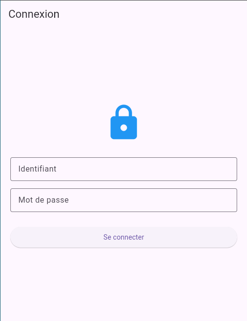
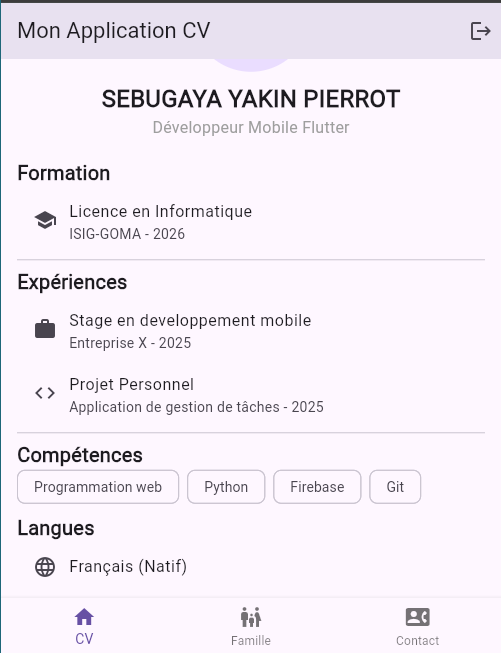
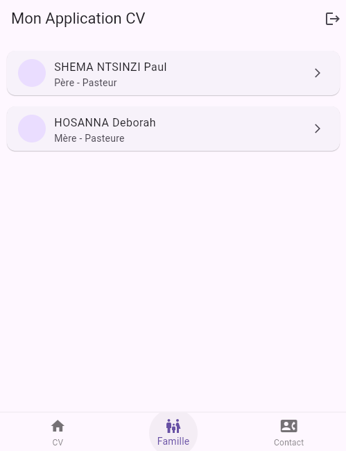
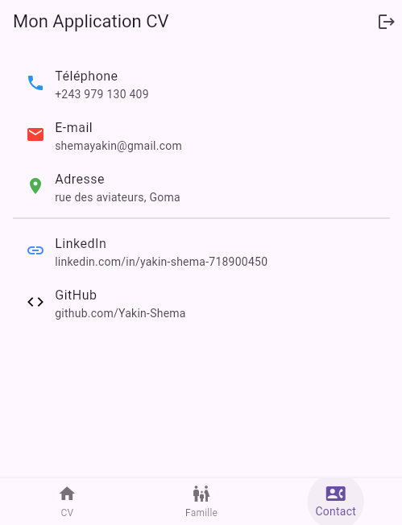

# Application CV - Flutter

Cette application mobile Flutter a été réalisée dans le cadre d'un projet. Elle présente mon CV, ma famille et mes coordonnées. L'accès à l'application est sécurisé par une page de connexion.

## Fonctionnalités
- **Page de connexion** : Accès sécurisé avec identifiant et mot de passe masqué.
- **Page CV** : Présentation complète (photo, formation, expériences, compétences, langues, centres d'intérêt).
- **Page Famille** : Liste des membres de ma famille avec photos et liens de parenté.
- **Page Contact** : Coordonnées cliquables (téléphone, e-mail, adresse, LinkedIn, GitHub).
- **Navigation** : Utilisation d'une `BottomNavigationBar` pour naviguer facilement entre les pages.

## Technologies utilisées
- Flutter / Dart
- Package `url_launcher` pour les liens cliquables

## Aperçu de l'application

| Connexion | CV | Famille | Contact |
| :---: | :---: | :---: | :---: |
|  |  |  |  |
